# Rapport de projet : SharesKnowledge

Projet Flutter « Investment Companion »
Module Compilation et Développement d'Applications Mobiles, FISA Informatique 5ᵉ année, 2025-2026
Auteur : Théo Bernaville

---

## 1. Concept et objectifs

SharesKnowledge aide un débutant complet à comprendre l'investissement en manipulant de vraies données historiques, sans argent réel, sans compte bancaire ni courtier, sans compte utilisateur. Chaque rubrique répond à une question :

| Rubrique | Question | Contenu |
| --- | --- | --- |
| **Learn** | Comment fonctionne cette notion ? | 6 leçons avec curseurs et graphique : rendement, composé, volatilité, baisse maximale, DCA, diversification. |
| **Playground** | Que se serait-il passé avec mes paramètres ? | Actif, montant, période, versement unique ou mensuel ; résultat, graphique, rejeu animé. Portefeuille fictif. |
| **Past Trader** (IA) | Qu'aurais-je décidé sans connaître la suite ? | Partie 2018-2020, 10 000 $, 16 actifs, futur caché, stop-loss et objectif, pause aux grandes nouvelles, bilan face au S&P 500. |
| **Perfect Foresight** (IA) | Que gagnerait-on en connaissant le futur ? | Parcours par décennie (de 1970 à 2020) qui illustre le biais rétrospectif. |

Objectifs : relier un pourcentage à un montant et une durée, montrer que le rendement va avec un risque, opposer le jugement *après coup* à la décision *sans connaître la suite*, et rappeler que le passé ne prédit pas l'avenir.

## 2. Fonctionnalités prévues et réalisées

| Fonctionnalité | Prévu | Réalisé |
| --- | --- | --- |
| Accueil, navigation, profil, sauvegardes | Oui | Oui |
| Playground : formulaire, résultat, graphique, rejeu | Oui | Oui |
| Cache des cours et hors connexion | Oui | Oui |
| Learn | 2 leçons | 6 leçons |
| Perfect Foresight | 1 scénario | 6 décennies (IA) |
| Past Trader | Oui | Oui (IA) |
| Médailles et progression | Oui | Oui (14 médailles, paliers Fer, Cuivre, Or, Diamant) |
| Portefeuille fictif « Mon portefeuille » | Non | Oui, ajouté en cours de projet |
| Comparaison de stratégies, scénarios « Blind » | Idée | Non (médailles « bientôt ») |

## 3. Captures d'écran

Captures prises sur téléphone Android. Les GIF enchaînent plusieurs écrans d'un même parcours (dans un PDF, seule la première image apparaît).

| | | |
| --- | --- | --- |
|  Accueil | 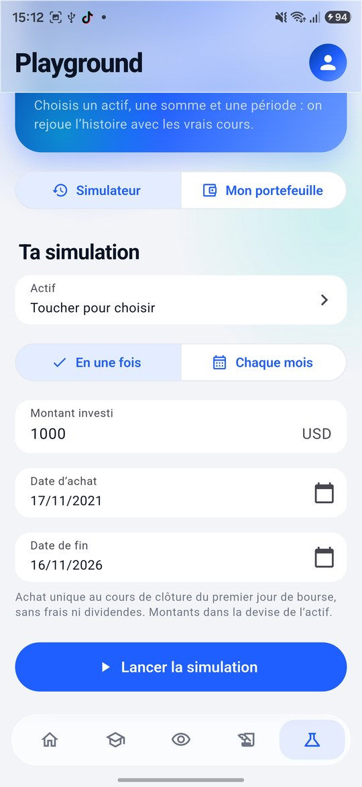 Formulaire Playground | 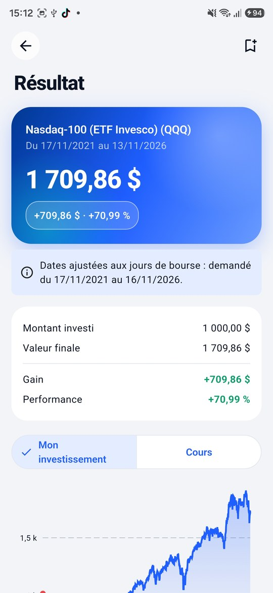 Résultat |
| 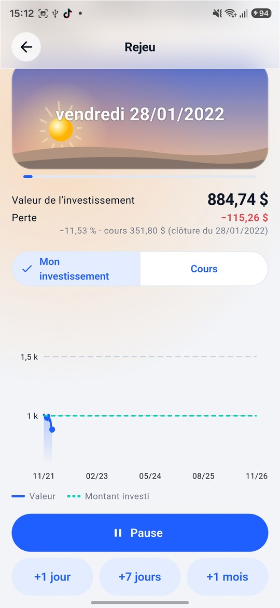 Rejeu animé | 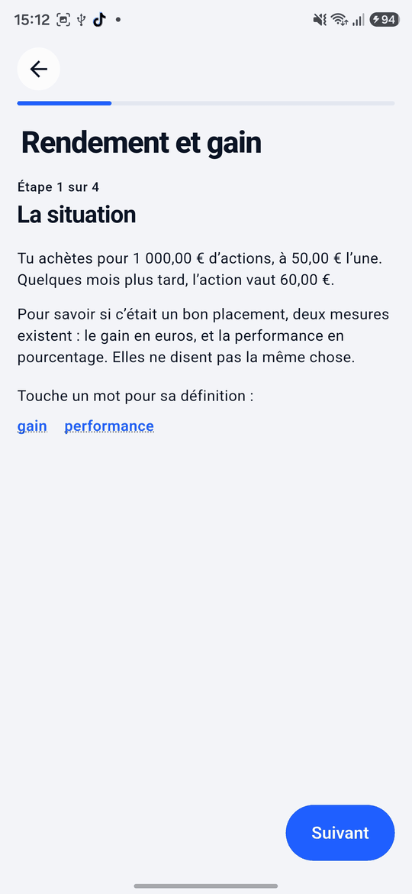 Leçon « Rendement et gain » (GIF, 4 étapes) | 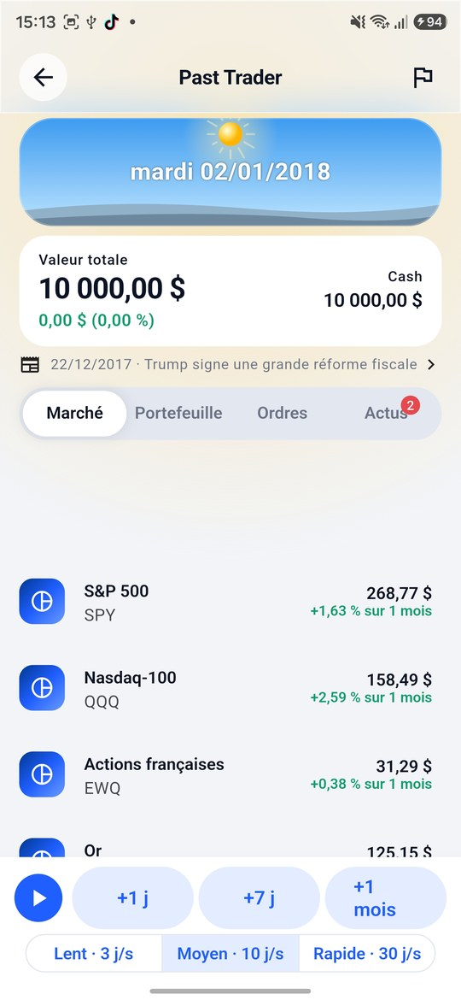 Past Trader |
| 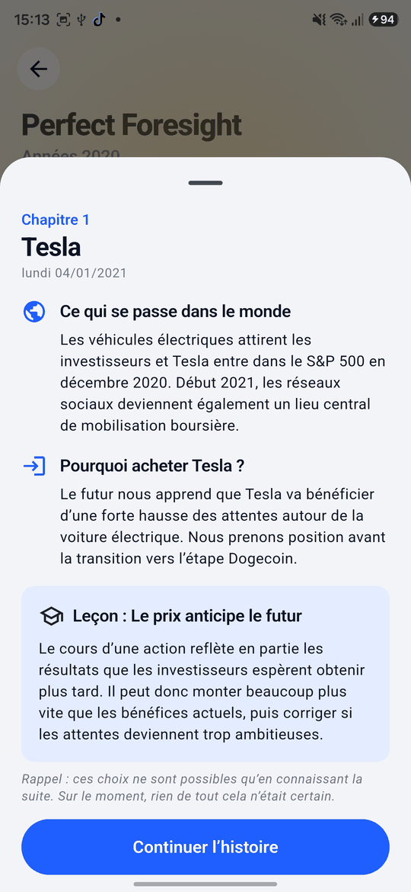 Perfect Foresight (GIF, chapitre, lecture, bilan) | 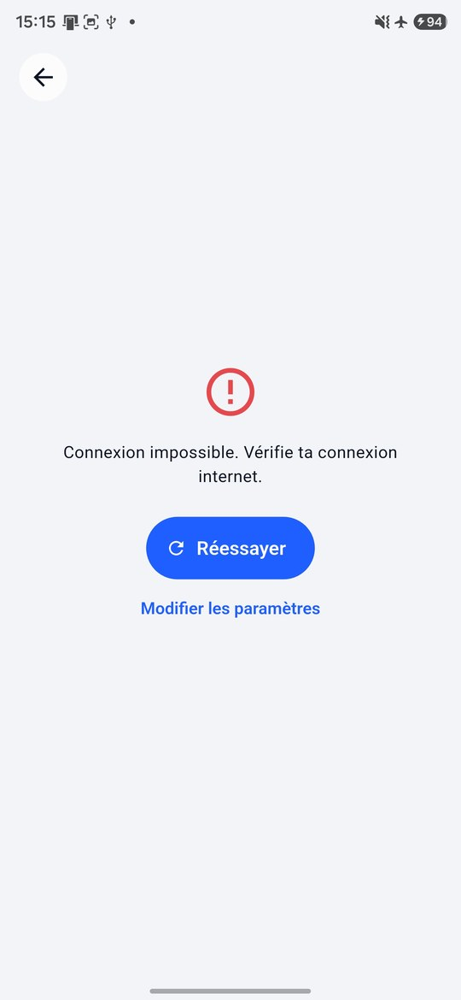 Erreur réseau et « Réessayer » | 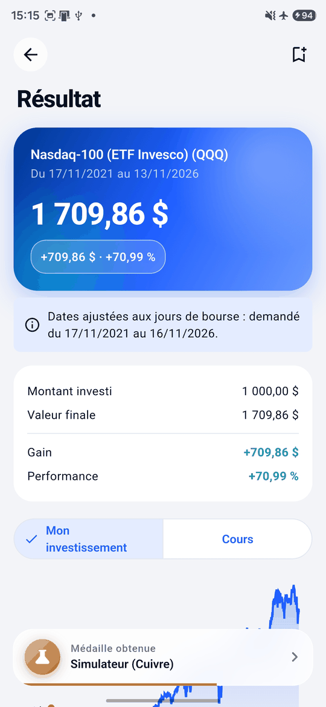 Médaille obtenue et progression (GIF) |

## 4. Architecture

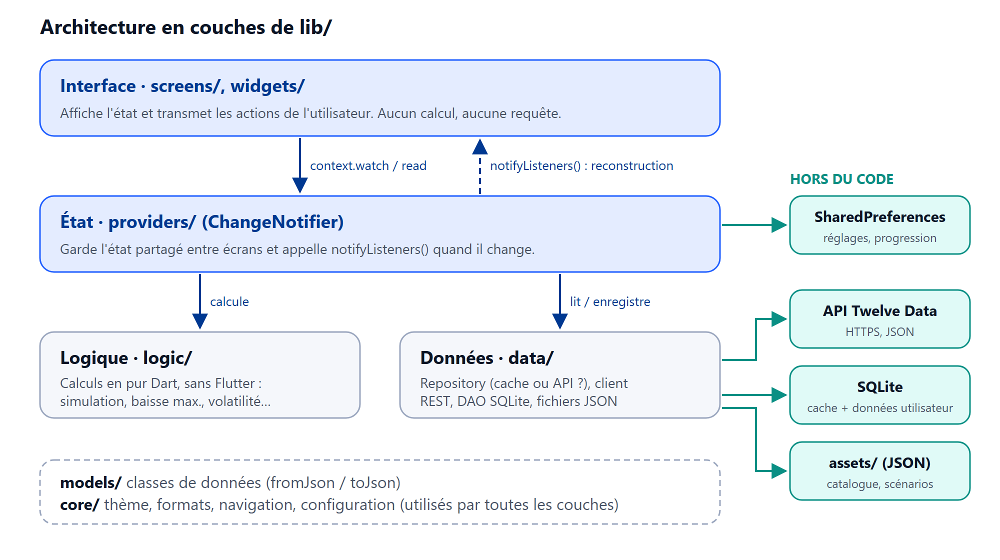

Le code est découpé par rôle (couches ci-dessus), puis par rubrique dans chaque couche. Règle suivie partout : un écran ne calcule rien et ne fait aucune requête ; il passe par un provider.

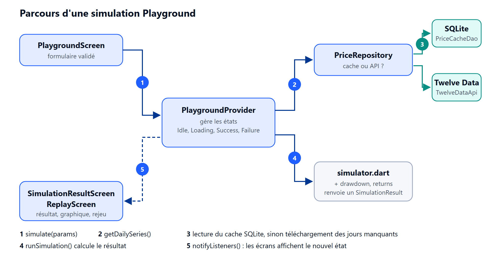

Réponses aux questions du sujet :
- État : dans des `ChangeNotifier` placés au-dessus de l'application (`MultiProvider`) : il survit aux reconstructions et se partage entre écrans. L'état purement visuel (onglet, animations, saisie) reste dans le `State` du widget.
- Cache ou API : seul `PriceRepository` décide.
- Calculs : dans `logic/`, en pur Dart, testables et réutilisés (la baisse maximale sert à 4 rubriques).
- Persistance : chaque DAO est la seule classe qui contient le SQL de sa table.
- Erreurs : le client API lève des exceptions typées ; le repository compense par le cache quand il peut ; le provider transforme le reste en état `Failure` avec un message.
- Reconstruction d'un widget : rien n'est perdu ni relancé (état dans les providers, aucune requête dans `build`, `IndexedStack` pour les onglets).
- Injection de dépendances : client HTTP, base et horloge sont passés en paramètre, ce qui rend tout testable sans réseau.

## 5. Gestion des états

Choix : provider + ChangeNotifier. `setState` seul obligerait à faire passer l'état d'écran en écran ; Riverpod ou Bloc apportent plus de structure, mais aussi plus de concepts pour un projet de cette taille. `provider` est recommandé par la documentation Flutter et je sais l'expliquer entièrement.

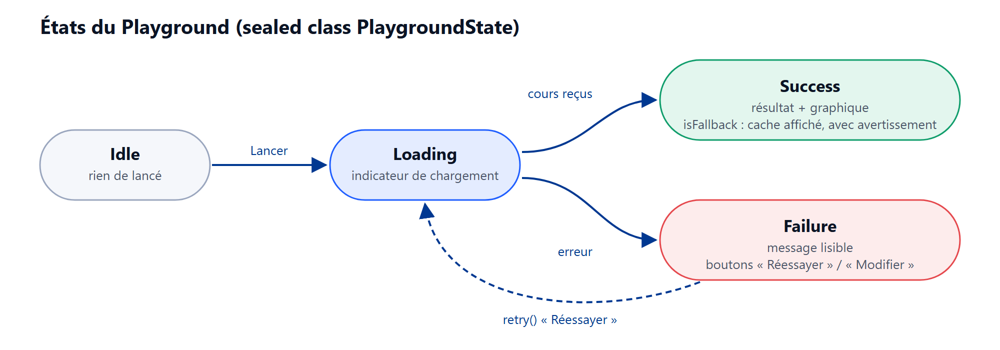

`sealed` oblige l'écran à traiter tous les cas : en oublier un empêche la compilation. Le cas « données anciennes » est porté par `isFallback`. Les données chargées une fois (catalogue) utilisent un `FutureBuilder`. Les états métier (aucune sauvegarde, portefeuille vide, partie en cours, hors connexion, premier démarrage) ont chacun leur affichage ; les médailles ne sont pas stockées mais déduites de la progression.

## 6. Persistance locale

| Outil | Contenu |
| --- | --- |
| SQLite (`sqflite`) | Cache des cours (données API) ; simulations, portefeuille, parties Past Trader (données utilisateur). |
| SharedPreferences | Profil, réglages, compteurs de progression. |

Pas de base distante : sans compte utilisateur, tout reste sur le téléphone.

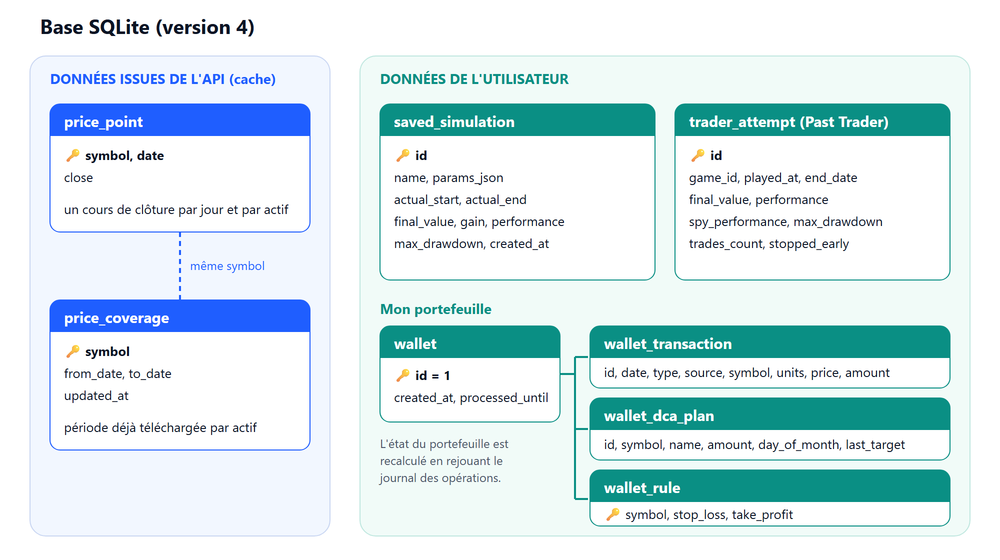

- Dates en texte `AAAA-MM-JJ` : l'ordre du texte est l'ordre chronologique.
- `params_json` garde les paramètres pour relancer une simulation ; les chiffres clés ont leurs colonnes pour afficher la liste sans recalcul.
- Le portefeuille est un journal d'opérations rejoué pour obtenir l'état : aucune incohérence possible entre solde et historique.
- `onUpgrade` ajoute les tables manquantes (de la version 1 à la version 4) sans effacer le cache existant.

## 7. Cache, invalidation et hors connexion

Un cours de clôture passé ne change jamais : une période téléchargée n'est jamais redemandée, et le passé n'a pas besoin d'expiration. `price_coverage` mémorise la période couverte par actif : sans elle, on ne distinguerait pas « pas de cours ce samedi » de « pas encore téléchargé ».

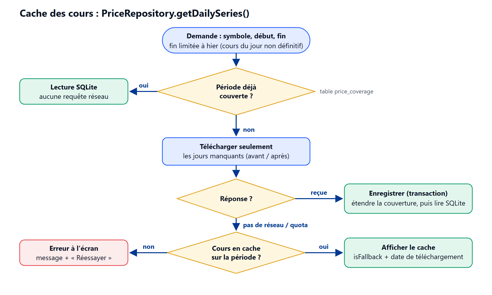

- Incrémental : passer de 2015-2020 à 2015-2024 ne télécharge que 2020-2024 (quota gratuit : 8 requêtes/min, 800/jour).
- Arrêt à hier : seuls des cours définitifs sont gardés. L'actualisation est naturelle : le lendemain, seul le nouveau jour manque.
- Transaction et clé primaire (symbol, date) : pas d'enregistrement partiel ni de doublon.
- Limite connue : une correction historique du fournisseur ne serait pas vue (la remise à zéro du profil permet de repartir de zéro).

Hors connexion, fonctionnent : les actifs déjà consultés, les sauvegardes, le profil, Learn, Past Trader et Foresight (données embarquées), le portefeuille aux derniers cours connus. Un actif jamais consulté affiche une erreur avec « Réessayer ». Un bandeau signale l'absence de réseau et le résultat indique la date des données.

## 8. API et données

- Twelve Data `GET /time_series` (interval `1day`, plage de dates, `outputsize=5000`) : une seule API pour actions, ETF et cryptos, avec recherche par dates, ce qui permet le téléchargement incrémental. Seul le cours de clôture est exploité.
- Clé API dans `env.json` (ignoré par Git), injectée à la compilation (`--dart-define-from-file`).
- JSON vers Dart : `jsonDecode` puis `PricePoint.fromJson` écrit à la main (plus simple à expliquer que du code généré).
- Erreurs : Twelve Data peut renvoyer une erreur avec le code HTTP 200 ; le client vérifie donc aussi le corps et lève `NetworkException`, `QuotaExceededException`, `InvalidApiKeyException`, `NoDataException` ou `BadResponseException`.
- Données embarquées : catalogue de 33 actifs vérifiés auprès de l'API (8 ETF, 20 actions, 5 cryptos ; l'offre gratuite exclut les bourses européennes), cours et actualités de Past Trader, parcours Foresight.

## 9. Calculs métier

Tous dans `lib/logic/`, en pur Dart, testés.

| Calcul | Formule |
| --- | --- |
| Gain / performance | `final − investi` ; `(final − investi) / investi` |
| Rendement annualisé | `(final / investi)^(1 / années) − 1`, pas sous un an |
| Rendement composé | `capital × (1 + taux)^années` (comparé aux intérêts simples) |
| Baisse maximale | plus forte chute `(sommet − valeur) / sommet` depuis le plus haut sommet |
| Gain pour revenir après une perte | `1 / (1 − perte) − 1` (après −50 %, il faut +100 %) |
| Volatilité | écart type (n − 1) des rendements |
| DCA | chaque mois `parts += montant / cours` ; valeur = `parts × cours` |
| Portefeuille | `cash + Σ parts × cours`, prix de revient moyen pondéré |

Points délicats : achat au premier jour coté (un samedi devient le lundi) ; baisse maximale du DCA calculée sur le cours (les versements masqueraient les chutes) ; 31 janvier + 1 mois = fin février et non 3 mars.

## 10. Animations

| Animation | Type | Implémentation |
| --- | --- | --- |
| Cycle soleil / lune | programmée | `AnimationController` + `CustomPainter` |
| Révélation du graphique | programmée | `AnimationController` + `Tween` + `AnimatedBuilder` |
| Lecture automatique | programmée | `AnimationController` dont la valeur, de 0 à 1, donne la position dans la période |
| Compteur du capital | implicite | `TweenAnimationBuilder` |
| Courbes des leçons, barre du bas | implicites | `fl_chart`, `AnimatedOpacity`, `AnimatedContainer` |

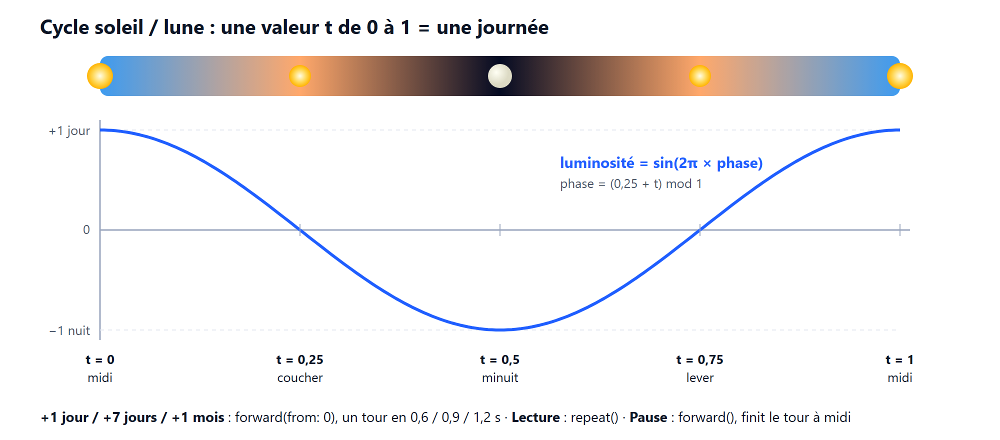

Le peintre est abonné au contrôleur (`repaint: cycle`) : à chaque image, seul le dessin est refait, sans reconstruire de widget. Les contrôleurs sont libérés dans `dispose()`, et le réglage « Supprimer les animations » du téléphone (ou du profil) est respecté.

## 11. Scoring et recommandations

Volontairement, aucune recommandation d'achat : elle donnerait l'impression de conseiller un débutant. À la place : la comparaison au S&P 500 dans Past Trader (« auriez-vous fait mieux en achetant l'indice ? ») et des médailles qui récompensent l'exploration, jamais un gain.

## 12. Tests

405 tests (`flutter test`) : calculs et cas limites (`test/logic/`), JSON, API avec un faux client HTTP, cache avec une base SQLite en mémoire (`test/data/`), providers et écrans (tests de widgets). Cas limites couverts : historique vide, montant nul, dates inversées, week-end, perte totale, division par zéro, 31 janvier + 1 mois, quota renvoyé en HTTP 200, réseau coupé avec et sans cache, limite des 5 000 points.

La plupart des tests ont été écrits avec l'aide de l'IA, par manque de temps ; je sais expliquer ce qu'ils vérifient et comment.

## 13. Utilisation de l'IA

Fait à la main : architecture, API et cache, SQLite, hors connexion, Learn, Playground, animations, thème, navigation, profil, sauvegardes, médailles, portefeuille.

Avec l'aide de l'IA (signalé dans l'app par une pastille « AI ») :
- Past Trader : code (`lib//past_trader/`), cours réels 2018-2020, actualités rédigées par IA, scripts `tool/`.
- Perfect Foresight : code (`lib//foresight/`), parcours proposés par GPT puis recalculés avec les vrais cours, scripts `tool/`.
- La plupart des tests.

## 14. Difficultés, limites, améliorations

Difficultés : débuter en Flutter (cycle de vie, `AnimationController`), le cache incrémental, les pièges de l'API (erreur en HTTP 200, limite de 5 000 points, quota), les dates (jours non cotés, fins de mois, UTC), un périmètre qui a beaucoup grandi.

Limites : pas de dividendes ni de frais ; montants en devise d'origine (pas de risque de change) ; actifs américains et cryptos seulement ; impôts simplifiés ; pas de synchronisation entre appareils ; pas de tests d'intégration.

Améliorations : conversion EUR/USD, comparaison de deux stratégies, scénarios « Blind », recherche de symboles via l'API, dividendes et frais, tests d'intégration.

## 15. Conformité au sujet

| Contrainte | Réalisation |
| --- | --- |
| ≥ 3 écrans + navigation | Accueil, Learn, Playground, Past Trader, Foresight, Portefeuille, Profil, Progression |
| Formulaire validé | Playground : actif, montant > 0, début < fin, fin au plus tard hier |
| Liste dynamique | Catalogue filtrable, sauvegardes, opérations, actualités |
| API REST et conversion JSON en Dart | Twelve Data, `fromJson` manuel |
| Persistance métier | SQLite + SharedPreferences |
| Cache local | `price_point` / `price_coverage`, jours manquants seulement |
| Hors connexion partiel | Cache, sauvegardes, contenus embarqués, bandeau |
| États chargement / données / erreur | `sealed class`, `FutureBuilder`, états vides |
| Visualisation | Courbes `fl_chart` (cours, valeur, baisse maximale) |
| ≥ 2 calculs métier | Performance, gain, baisse maximale, annualisé, volatilité, DCA… |
| ≥ 3 animations dont 2 codées | Ciel, révélation, lecture (programmées) ; compteur, transitions |
| Tests unitaires | 405 tests, toute la logique de `lib/logic/` |
